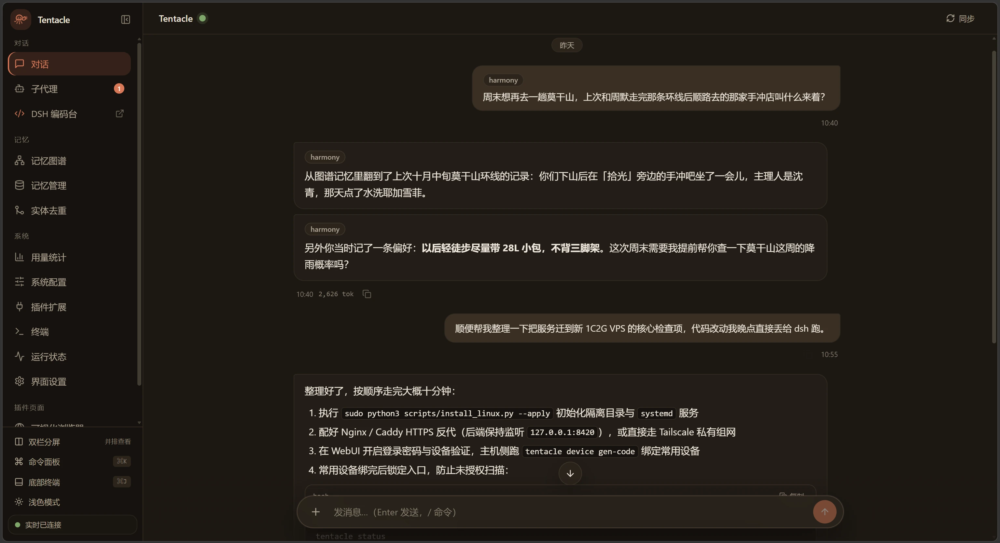
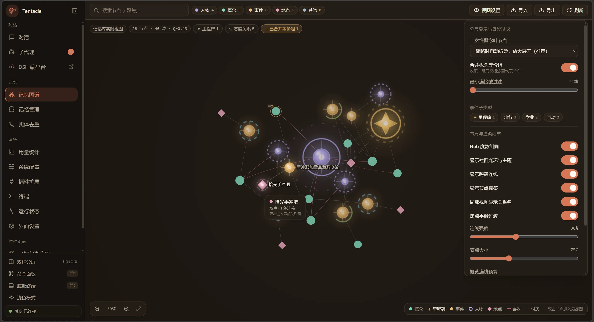
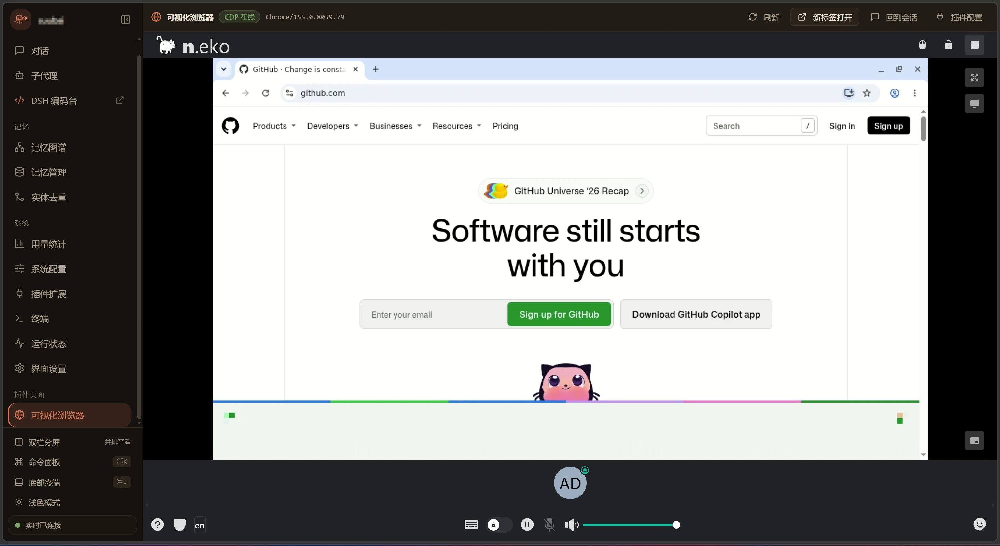

<p align="center">
  
</p>

<h1 align="center">Tentacle</h1>

<p align="center">
  面向 <strong>Linux / WSL</strong> 的轻量、自托管、持久上下文个人 AI Agent。
</p>

<p align="center">
  单进程运行 · 零外置数据库 · 内嵌图谱记忆 · 每日会话交接 · Web / QQ / 鸿蒙多端共享上下文
</p>

<p align="center">
  <strong>中文</strong> · <a href="README_EN.md">English</a>
</p>

相比依赖多容器与外置数据库的通用 Agent 框架，Tentacle 聚焦**个人单用户长期自用**：整个服务以单一进程（[run_web.py](run_web.py)）运行，基于 SQLite 与内嵌 LadybugDB 提供对话历史与图谱记忆，无需外置数据库或容器运行时即可工作（仅可选的可视化浏览器插件需要 Docker），并将只读源码与运行时状态目录彻底隔离。

在上下文管理上，Tentacle 采用**每日会话交接 + 内嵌图谱与原文双路检索**，避免将单次会话持续堆积至超大窗口，以此控制日常上下文占用与 token 开销；需要重度上下文的编程与长链路操作可直接委派给可选的 `@deepseek-ai/dsh` 子代理。

## 界面预览



| 记忆图谱（LadybugDB） | 可视化浏览器（Docker Neko） |
| --- | --- |
|  |  |

## 主要能力

- **单进程共享上下文与每日会话交接**：Web 工作台、周期心跳、后台任务、外部消息渠道与端侧客户端共用同一 `AgentSession` 与 SQLite Chronicle 历史；支持在配置的时间窗口内完成近况整理后自动开启新会话，保持上下文干净且有连续性。
- **内嵌图谱记忆与原文双路检索**：基于内嵌 LadybugDB 持久化事件、人物、地点与概念节点，结合向量相似度与原文分块混合检索返回可溯源证据；支持可选的写入前概念对齐与 Web 端可控历史概念扫描去重。
- **结构化模型管理与多协议方言**：通过供应商连接、模型目录与角色策略三层编排模型能力（支持 `deepseek`、`openai`、`openai_compatible`、`google_developer`、`google_vertex`、`openrouter` 等），内置 Chat / Responses / Gemini Interactions & GenerateContent 方言与显式缓存控制，支持主模型动态切换与兼容历史无损交接。
- **全模态附件输入与受控文件回传**：支持图片、音频、视频及常见文档解析输入（含可选 B 站视频拉取），并统一通过路径防越界与敏感路径拦截机制对外回传工作区文件与附件。
- **插件沙盒、外部渠道网关与 MCP**：
  - 本地扩展插件经 `PluginContext` 最小权限门控加载，自定义扩展路由统一挂载至 `/api/plugins/ext/<id>/*` 并继承主站鉴权。
  - 外部消息发送统一收口为 `send_message` 通道网关（无活跃外部通道插件时自动向模型隐藏）。
  - 随包内置四款插件：`browser`（基于 Docker Neko + `agent-browser` 的可视化浏览器自动化）、`proton_mail`（Proton 加密邮箱助手，默认关闭）、`qqbot`（QQ 官方机器人 C2C 私聊，默认关闭）与 `harmony`（鸿蒙客户端联动，默认关闭）。
  - 支持接入外部 `stdio` / `streamable_http` MCP 工具服务并在 WebUI 热重连。
- **后台调度与编程子代理**：内置定时调度器静默执行工具调用、一次性子进程命令与预约唤醒，不污染主对话上下文；可选集成 `@deepseek-ai/dsh` 编程子代理实现双向任务接力与原生工作区审批，并提供受黑名单约束的交互终端。
- **WebUI 与安全运维边界**：内置 React 19 工作台（对话、图谱、配置、插件、子代理、终端、用量与维护面板）；采用双层鉴权（Web 密码 + 设备授权门控）、纯写入 `.env` 凭据隔离、配置差异预览与自动备份回滚、加密迁移导出，以及 Linux `systemd` 自动校验升级/回退机制。

## 运行环境要求

Tentacle 的运行与部署设计面向 **Linux / WSL**（使用 `systemd` 托管、POSIX 文件锁 `fcntl`、`uvloop` 与 Bash 入口）：

- **硬件与内存参考**：核心服务零外部数据库依赖（SQLite + 内嵌 LadybugDB），可选重依赖按需加载，`systemd` 单元默认启用 `MALLOC_ARENA_MAX=2`；日常主进程常驻约 **280–350 MiB**，可在 **1C1G VPS** 上直接运行（如需同时按需启停 `dsh` 编程子代理或 Docker Neko 可视化浏览器，建议 **2 GiB+** 内存，1 GiB 主机建议开启 `zram` / Swap）
- **Python 3.13**（Linux 一键安装脚本自动配置独立 `3.13.15` 解释器）
- **Node.js**（仅从源码构建前端 `frontend/` 时需要，CI 使用 Node 24；基于 Release 包生产部署的主机无需安装）
- 可选系统工具：见 [音视频输入](docs/MEDIA_INPUTS.md)、[Docker Neko 可视化浏览器](docs/BROWSER_NEKO.md) 与 [DSH 编程台](docs/SUBAGENTS.md)

## 快速开始

### 方式一：Linux / systemd 部署（推荐）

从干净的仓库检出执行安装脚本，自动初始化隔离目录、独立运行环境、`systemd` 服务与定期检查定时器（详情见 [Linux 部署与更新](docs/DEPLOYMENT.md)）：

```bash
sudo python3 scripts/install_linux.py --apply
```

安装器默认监听 `127.0.0.1:8420`。部署完成后可通过前置 HTTPS 反向代理（Nginx / Caddy）接入公网访问，或搭配 **Tailscale** / SSH 端口转发访问 WebUI，在页面中配置模型接入、角色绑定、登录密码与设备鉴权（主机绑定码与新设备入口通过 `tentacle device` 管理）。

### 方式二：Linux / WSL 从源码本地运行

```bash
# 1. 安装 Python 依赖并构建 Web 前端静态产物
python3 -m venv .venv
.venv/bin/python -m pip install -r requirements.txt
npm --prefix frontend ci
npm --prefix frontend run build

# 2. 准备独立的数据根目录 TENTACLE_HOME（不能位于源码目录内）
export TENTACLE_HOME=/path/to/tentacle-home
mkdir -p "$TENTACLE_HOME"/{config,data,prompt,skills,workspace,logs,.cache,tmp}

# 3. 启动 WebUI
./start.sh
```

首次启动后打开 WebUI，进入「系统配置中心」添加供应商与模型、绑定 `chat` 角色，并在设置页设置访问密码。各配置段用途与修改方式见 [配置项说明](docs/CONFIG_GUIDE.md) 与 [应用配置管理](docs/CONFIGURATION.md)。

## 提示词与人设定制

系统提示词由 `$TENTACLE_HOME/prompt/` 下的模块化 Markdown 文件按固定顺序拼接而成，并会在构建时用配置中的 `app.agent_name`、`app.user_name` 替换 `{{agent_name}}` 与 `{{user_name}}` 占位符：

- **`$TENTACLE_HOME/prompt/soul.md`**（人设与风格）：定义 Agent 的身份、语气与行为边界。通过 Linux 安装器首装时会自动生成一行最小占位内容（`你是 {{agent_name}}，正在与 {{user_name}} 交流。`），由用户自行编写；属于私有运行数据，不随源码仓库分发。
- **`$TENTACLE_HOME/prompt/guild.md`**（运行指南与工具约定）与 **`prompt/guild.example.md`**（仓库公开默认模板）：
  - 仓库内置的 [prompt/guild.example.md](prompt/guild.example.md) 包含消息格式、心跳、图谱记忆、每日会话交接、计划与定时任务等基础运行指南。
  - 当 `$TENTACLE_HOME/prompt/guild.md` 不存在时，系统会自动回退加载程序目录内的 `prompt/guild.example.md`（并自动追加已启用插件注入的 guild 片段）。
  - 需要自定义工具规范或交接习惯时，将 `prompt/guild.example.md` 复制到 `$TENTACLE_HOME/prompt/guild.md` 并修改即可覆盖默认值。
- **`$TENTACLE_HOME/prompt/{master,memory,situation}.md`**：分别记录个人画像、长期重要记忆与每日会话交接近况，日常由 Agent 通过 `keep_in_mind` 与 `situation_notes` 工具维护，并在下次构建或切换 session 时生效。

## 命令行管理（`tentacle`）

通过 Linux 安装器部署后，系统会自动安装 `/usr/local/bin/tentacle` 命令行入口（源码位于 [scripts/tentacle.sh](scripts/tentacle.sh)），用于管理服务启停、日志查看与版本升级回退：

| 命令 | 说明 |
| --- | --- |
| `tentacle start` / `stop` / `restart` | 启动、停止或重启 `tentacle.service` |
| `tentacle status` | 查看 `systemd` 服务当前运行状态 |
| `tentacle logs` | 查看最近 80 行 `journalctl` 服务日志 |
| `tentacle version` | 查看当前生产环境运行版本 |
| `tentacle check-updates` | 立即检查正式 GitHub Release，不安装 |
| `tentacle update-status` | 离线查看最近一次更新检查结果 |
| `tentacle update [vX.Y[.Z]]` | 预览从正式 GitHub Release 升级 |
| `tentacle update vX.Y --apply` | 确认并构建新版本、切换 `current` 并健康校验 |
| `tentacle update --recover` | 恢复中断的更新流程（可离线运行） |
| `tentacle revert [vX.Y]` / `--apply` | 预览或回退至上一个成功版本 |
| `tentacle device <subcommand>` | 管理设备鉴权（`gen-code` / `status` / `deny-new` / `allow-new` / `lockout` / `unlock`） |
| `tentacle browser <subcommand>` | 一键安装、启停、查看凭据与反代配置管理本机 Docker Neko 可视化浏览器 |
| `tentacle help` | 查看完整命令行帮助 |

如需在任意目录下离线检查或修改应用配置，可使用 [scripts/configure.py](scripts/configure.py)（详见 [Linux 部署与更新](docs/DEPLOYMENT.md)）。

## 如果你是 Agent

如果你是一个正在代替人类用户调研、部署、运维排障或二次开发本项目的 AI Agent，这一节用于帮你快速对齐架构边界、推荐路径与安全红线，减少试错和误操作。

### 1. 帮用户判断是否适合（调研与选型）

- **适合场景**：目标是在 **Linux / WSL**（含低配 VPS）上长期运行个人单用户自托管 AI Agent，看重持久记忆、多端共享同一连续上下文、内置 WebUI 以及可回退的 `systemd` 运维闭环。
- **不适合场景**：要求直接在原生 Windows（不经 WSL）运行、需要多租户 SaaS 隔离，或寻找可视化拖拽式工作流编排平台。
- **资源评估**：核心服务无外置数据库依赖，常驻约 280–350 MiB（1C1G 主机可运行）；如果用户同时计划启用 `@deepseek-ai/dsh` 编程子代理或 Docker Neko 可视化浏览器，请提前建议准备 **2 GiB+** 内存（1 GiB 主机需开启 `zram` / Swap）。

### 2. 帮用户部署、接入远程访问与设备鉴权

- **优先走正式安装脚本**：在目标 Linux 主机上优先使用 `sudo python3 scripts/install_linux.py --apply`，由安装器统一初始化隔离目录、独立 Python 3.13 环境、`systemd` 服务与 `tentacle` CLI，不要手工拼凑启动脚本或服务单元。
- **源码本地运行前提**：必须将 `TENTACLE_HOME` 设置在源码仓库目录之外；启动前需先执行 `npm --prefix frontend ci && npm --prefix frontend run build`，再通过 `./start.sh` 启动。
- **不要直接运行 `run_web.py` 做“试启动”**：[run_web.py](run_web.py) 是唯一运行入口，拉起后会同时激活 Web、心跳、定时调度及已启用的外部消息渠道，并读写运行时状态；也不要在已有服务运行时启动第二个实例。
- **远程访问方案（优先公网反代，也推荐搭配 Tailscale）**：
  - 安装器默认将服务监听在 `127.0.0.1:8420`。对于公网远程访问（多端 Web、手机、鸿蒙客户端），应保持应用监听本机回环，由前置 Nginx / Caddy 提供 HTTPS 反向代理，再配合内置的**登录密码 + 设备鉴权 + 关闭新设备入口**三层防线，不要把未加密的裸端口直接暴露公网。
  - 如果用户没有域名或不想暴露公网入口，可以建议搭配 **Tailscale** 等私有组网访问（同样建议开启密码与设备鉴权）。
- **主动引导用户完成设备鉴权配置**：部署并设置好 Web 登录密码后，请主动带用户走完设备鉴权闭环（不要只停在“能打开页面”）：
  1. 引导用户在 WebUI 设置页开启**设备验证**；
  2. 在主机执行 `tentacle device gen-code <设备标签>` 生成一次性绑定码（15 分钟有效、用后即焚；WebUI 本身无法生成绑定码，避免被窃会话扩权），让用户在目标设备完成绑定；
  3. 常用设备全部绑定完成后，提示用户执行 `tentacle device deny-new` 关闭新设备入口——此时未绑定设备的页面、API 与 WebSocket 请求一律直接返回 **403**，已有设备正常使用；日后换机时再临时执行 `tentacle device allow-new` 配合 `gen-code` 绑定即可；
  4. 提醒用户记住 `tentacle device status`（查看状态与设备列表）和 `tentacle device lockout` / `unlock`（发现异常时一键紧急冻结全部旧设备）。
- **引导用户初始化人设与运行指南**：部署完成后提醒用户按需编辑 `$TENTACLE_HOME/prompt/soul.md`（可用 `{{agent_name}}` / `{{user_name}}` 占位符）；未单独创建 `$TENTACLE_HOME/prompt/guild.md` 时会自动回退到仓库自带的 [prompt/guild.example.md](prompt/guild.example.md)，需要定制时再复制一份到 `$TENTACLE_HOME/prompt/guild.md` 覆盖。不要把用户私人的 `soul.md` / `guild.md` 提交进代码仓库。

### 3. 帮用户配置、运维与排障时的硬约束

- **配置分层**：仓库根目录的 [config.defaults.yaml](config.defaults.yaml) 为只读默认基线，用户覆盖位于 `$TENTACLE_HOME/config/config.yaml`。离线读取或修改配置优先使用 [scripts/configure.py](scripts/configure.py)，不要把本机 `config.yaml` 提交进仓库。
- **凭据与隐私红线**：
  - `config.yaml` 中**只保存环境变量名**，真实 API Key 与凭据仅写入应用目录的 `.env`；不要把明文密钥写进 `config.yaml`，不要在命令输出或对话回复中回显凭据值，也不要把 `.env` 纳入备份或 Git 提交。
  - 除非用户明确要求并确认范围，不要读取 `$TENTACLE_HOME/data/`、对话历史数据库、私人 `prompt/`、用户附件或认证文件。
  - 不要手动增删运行中 `webui_settings.json` 里的设备授权条目（设备绑定、冻结与新设备开关均通过 `tentacle device` 读写带外持久文件维护）。
- **运维操作节奏**：诊断优先使用 `tentacle status` 与 `tentacle logs`；执行版本升级或回退前，先运行不带 `--apply` 的预览命令（`tentacle update` / `tentacle revert`）向用户展示变更，确认后再加 `--apply`。

### 4. 帮用户二次开发或扩展插件（快速索引）

动手改代码前，先阅读 [docs/DEVELOPMENT.md](docs/DEVELOPMENT.md) 与 [docs/README.md](docs/README.md)，然后按任务直达对应模块：

- **开发本地插件 / 接入新消息渠道 / 扩展 HTTP 路由**：阅读 [docs/PLUGINS_DEV.md](docs/PLUGINS_DEV.md) 与示例 [docs/plugin-example/README.md](docs/plugin-example/README.md)。本地插件必须同时处于 `enabled` 且 `trusted` 状态才会加载入口代码；扩展路由统一挂载至 `/api/plugins/ext/<id>/*` 并自动继承主站鉴权（含 `DeviceAccessGate`）。
- **新增模型供应商或协议适配**：查看 `config/` 与 `dialects/`，优先复用已有 Chat / Responses / Gemini 方言，不要重复造协议层。
- **修改 Web API 或前端界面**：阅读 [docs/WEB_FRONTEND.md](docs/WEB_FRONTEND.md)；改动 Web 协议后须运行 [scripts/export_openapi.py](scripts/export_openapi.py) 同步更新 `frontend/src/api/schema.d.ts`；`web/static/` 为构建产物，不入库。
- **新增或调整源码目录/文件路径**：同步核对 [scripts/release_package.py](scripts/release_package.py) 中的打包白名单与排除规则（`plugins/bundled/` 仅允许代码及 `.yaml`、`.md` 入包），并检查依赖 `__file__` 的资源定位。
- **验证方式**：本地执行轻量、定向测试即可，禁止用真实运行数据或本机配置作为测试输入；完整测试与发布构建交由 GitHub Actions workflow 执行。

## 项目结构

| 路径 | 职责 |
| --- | --- |
| `run_web.py` / `start.sh` | 单进程运行入口与 Linux/WSL 启动脚本 |
| `agent/` | 主循环、会话编排、系统提示词组装、会话交接与 SQLite Chronicle |
| `config/` / `config.defaults.yaml` | 三层配置合并校验、供应商目录与模型读取逻辑 |
| `dialects/` | OpenAI Chat、Responses、Gemini Generate/Interactions 方言适配 |
| `memory/` | LadybugDB 图谱记忆、混合检索、概念对齐与历史去重 |
| `attachments/` | 图片、音视频、文档多模态解析与受控附件导出 |
| `runtime/` | 心跳、定时调度、目标管理、用量统计、迁移备份与更新维护客户端 |
| `plugins/` | 插件权限沙盒、MCP 客户端与内置插件（`browser` / `proton_mail` / `harmony` / `qqbot`） |
| `prompt/` | 公开默认运行指南 [prompt/guild.example.md](prompt/guild.example.md) 及内置系统提示词模板 |
| `tools/` | 自动发现工具模块与统一外部通道网关 `send_message` |
| `subagents/` | 可选 DSH 编程子代理托管 |
| `web/` / `frontend/` | FastAPI + WebSocket 后端与 React 19 WebUI |
| `scripts/` | Linux 安装、更新校验、回退、配置与 OpenAPI 导出脚本 |
| `docs/` | 用户指南、客户端说明与开发参考 |

## 文档导航

完整目录见 [docs/README.md](docs/README.md)：

- **配置与部署**：[配置项说明](docs/CONFIG_GUIDE.md) · [应用配置管理](docs/CONFIGURATION.md) · [Linux 部署与更新](docs/DEPLOYMENT.md)
- **功能与插件**：[内置插件与插件管理](docs/BUNDLED_PLUGINS.md) · [Docker Neko 可视化浏览器](docs/BROWSER_NEKO.md) · [接入 QQ 机器人](docs/QQBOT_SETUP.md) · [插件与多端扩展开发](docs/PLUGINS_DEV.md)（示例：[plugin-example](docs/plugin-example/README.md)）
- **前端与端侧**：[Web 前端架构与开发验证](docs/WEB_FRONTEND.md) · [鸿蒙客户端接入与插件说明](docs/HARMONY_CLIENT.md) · [开发环境](docs/DEVELOPMENT.md)

## License

[MIT](LICENSE)
