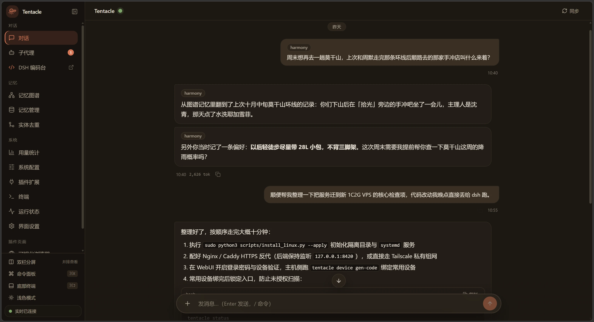
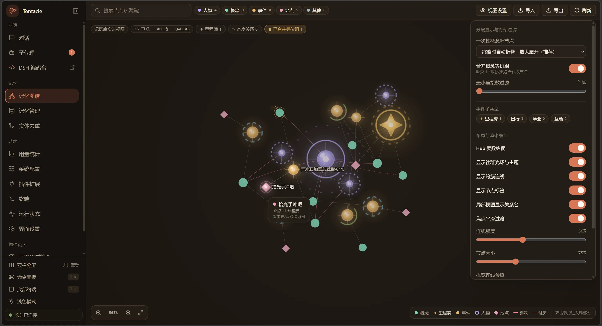
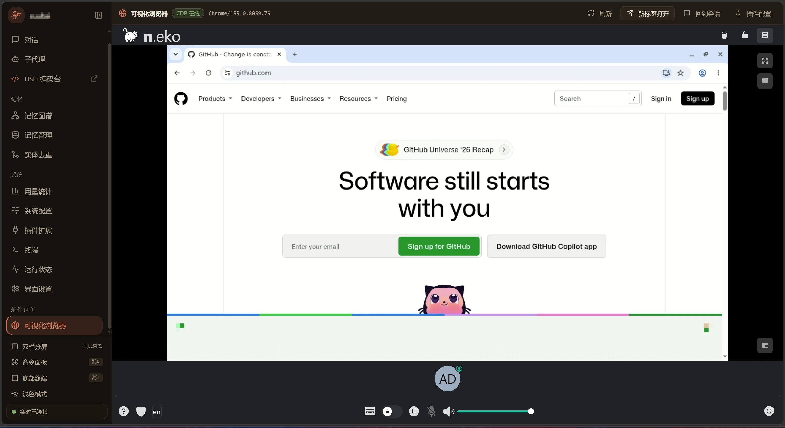

<p align="center">
  
</p>

<h1 align="center">Tentacle</h1>

<p align="center">
  A lightweight, self-hosted, persistent-context personal AI agent for <strong>Linux / WSL</strong>.
</p>

<p align="center">
  Single-process · No external DB · Embedded graph memory · Daily session handoff · Unified context across Web, QQ &amp; HarmonyOS
</p>

<p align="center">
  <a href="README.md">中文</a> · <strong>English</strong>
</p>

Rather than shipping a multi-container stack with external databases, Tentacle is built for **single-user, long-term personal self-hosting**. The entire service runs in a single process ([run_web.py](run_web.py)), backed by SQLite and an embedded LadybugDB graph store—requiring no external database or container runtime for core operation (only the optional visual browser plugin uses Docker)—with read-only application code strictly separated from runtime state.

For context management, Tentacle uses **daily session handoff paired with embedded graph and source-chunk retrieval** instead of letting a single session accumulate into an oversized context window. This keeps daily context size and token spend modest while preserving continuity; context-heavy coding or long-horizon tasks can be offloaded to the optional `@deepseek-ai/dsh` subagent.

## Screenshots



| Memory Graph (LadybugDB) | Visual Browser (Docker Neko) |
| --- | --- |
|  |  |

## Key Capabilities

- **Single-Process Shared Context & Daily Session Handoff**: Web workbench, periodic heartbeats, background tasks, external messaging channels, and native clients share one `AgentSession` and SQLite Chronicle history. Within a configured daily window, Tentacle summarizes recent context and rotates to a clean session without losing continuity.
- **Embedded Graph Memory & Hybrid Retrieval**: Persists events, people, locations, and concepts in embedded LadybugDB, combining vector similarity with source-chunk hybrid retrieval for traceable evidence. Supports optional pre-write concept alignment and UI-driven historical concept deduplication.
- **Three-Layer Model Management & Multi-Protocol Dialects**: Separates provider connections, model catalog, and role policies (`deepseek`, `openai`, `openai_compatible`, `google_developer`, `google_vertex`, `openrouter`, etc.), with built-in Chat, Responses, and Gemini GenerateContent / Interactions dialects, explicit prompt caching control, and live primary-model switching with compatible history handoff.
- **Multimodal Inputs & Guarded File Delivery**: Parses images, audio, video, and common documents (including optional Bilibili video fetching), while enforcing path-traversal checks and sensitive-path blocks on workspace file exports.
- **Sandboxed Plugins, Channel Gateway & MCP**:
  - Local plugins are gated by least-privilege `PluginContext` permissions; custom HTTP routes mount under `/api/plugins/ext/<id>/*` and inherit the main authentication and device-access middleware.
  - Outbound messaging to external platforms routes through a unified `send_message` gateway (automatically hidden from the model when no external channel plugin is active).
  - Ships with four bundled plugins: `browser` (Docker Neko + `agent-browser` visual browser automation), `proton_mail` (Proton Mail helper, disabled by default), `qqbot` (official QQ bot C2C DM, disabled by default), and `harmony` (HarmonyOS native client bridge, disabled by default).
  - Supports external `stdio` and `streamable_http` MCP servers with hot reload in the WebUI.
- **Orthogonal Scheduler & Coding Subagent**: Runs scheduled tool calls, one-shot subprocess commands, and scheduled wake-ups without polluting the main conversation context. Optionally integrates `@deepseek-ai/dsh` for bidirectional coding handoff and native workspace approvals, alongside a denylist-guarded interactive terminal.
- **React 19 WebUI & Operational Guardrails**: Full workbench (chat, memory graph, config, plugins, subagents, terminal, usage, status, and maintenance) with two-layer auth (Web password + out-of-band device authorization), write-only `.env` secret isolation, config diff preview with auto-backup/rollback, encrypted migration export, and verified Linux `systemd` upgrade/revert workflows.

## Requirements

Tentacle is designed for **Linux / WSL** (`systemd`, POSIX `fcntl` file locks, `uvloop`, and POSIX shell entrypoints):

- **Hardware & Memory**: Zero external database dependencies (SQLite + embedded LadybugDB) with optional heavy dependencies loaded on demand and `MALLOC_ARENA_MAX=2` set in the `systemd` unit. The main process typically sits around **280–350 MiB** RSS and runs directly on a **1 vCPU / 1 GiB VPS** (if you also run the `dsh` coding subagent or Docker Neko visual browser on demand, **2 GiB+ RAM** is recommended; enable `zram` / Swap on 1 GiB hosts).
- **Python 3.13** (automatically provisioned as an isolated `3.13.15` runtime by the Linux installer).
- **Node.js** (only needed when building `frontend/` from source; CI uses Node 24; production hosts installing from official Releases do not need Node.js).
- Optional host tools: see [Media Inputs](docs/MEDIA_INPUTS.md), [Docker Neko Visual Browser](docs/BROWSER_NEKO.md), and [DSH Subagents](docs/SUBAGENTS.md).

## Quick Start

### Option 1: Linux / systemd Deployment (Recommended)

Run the installer from a clean Git checkout to set up isolated directories, a dedicated runtime, `systemd` unit, periodic update checker, and `/usr/local/bin/tentacle` CLI (details in [docs/DEPLOYMENT.md](docs/DEPLOYMENT.md)):

```bash
sudo python3 scripts/install_linux.py --apply
```

By default the service listens on `127.0.0.1:8420`. Put an HTTPS reverse proxy (Nginx / Caddy) in front for public remote access, or connect over **Tailscale** / SSH port forwarding, then open the WebUI to configure model providers, role bindings, login password, and device authorization (managed on the host via `tentacle device`).

### Option 2: Run from Source on Linux / WSL

```bash
# 1. Install Python dependencies and build the React frontend
python3 -m venv .venv
.venv/bin/python -m pip install -r requirements.txt
npm --prefix frontend ci
npm --prefix frontend run build

# 2. Prepare an isolated runtime root TENTACLE_HOME (must sit outside the source tree)
export TENTACLE_HOME=/path/to/tentacle-home
mkdir -p "$TENTACLE_HOME"/{config,data,prompt,skills,workspace,logs,.cache,tmp}

# 3. Start the WebUI
./start.sh
```

After startup, open the WebUI, add a provider and model in **Configuration**, bind the `chat` role, and set a login password in **Settings**. See [docs/CONFIG_GUIDE.md](docs/CONFIG_GUIDE.md) and [docs/CONFIGURATION.md](docs/CONFIGURATION.md) for details.

## Prompt & Persona Customization

The system prompt is assembled in a fixed order from modular Markdown files under `$TENTACLE_HOME/prompt/`, rendering `{{agent_name}}` and `{{user_name}}` placeholders from `app.agent_name` and `app.user_name` in config:

- **`$TENTACLE_HOME/prompt/soul.md`** (Persona & Style): Defines the agent's identity, tone, and behavioral boundaries. The Linux installer seeds a minimal placeholder line on first install (`你是 {{agent_name}}，正在与 {{user_name}} 交流。`); customize it freely. It is private runtime state and never shipped with source releases.
- **`$TENTACLE_HOME/prompt/guild.md`** (Operating Guide & Tool Conventions) & **`prompt/guild.example.md`** (Bundled Public Template):
  - The repository includes [prompt/guild.example.md](prompt/guild.example.md) covering message formats, heartbeats, graph memory, daily session handoff, goals/schedules, and tool conventions.
  - If `$TENTACLE_HOME/prompt/guild.md` does not exist, Tentacle automatically falls back to `prompt/guild.example.md` in the application directory (and appends prompt fragments contributed by enabled plugins).
  - To customize tool rules or handoff behavior, copy `prompt/guild.example.md` to `$TENTACLE_HOME/prompt/guild.md` and edit your local copy.
- **`$TENTACLE_HOME/prompt/{master,memory,situation}.md`**: Store persistent user profile notes, key memories, and daily session handoff context, maintained by the agent via `keep_in_mind` and `situation_notes` and applied on the next prompt build or session switch.

## CLI Management (`tentacle`)

The Linux installer places `/usr/local/bin/tentacle` (from [scripts/tentacle.sh](scripts/tentacle.sh)) on the host for service lifecycle, device authorization, browser management, and verified upgrades/rollbacks:

| Command | Description |
| --- | --- |
| `tentacle start` / `stop` / `restart` | Start, stop, or restart `tentacle.service` |
| `tentacle status` | Show current `systemd` service status |
| `tentacle logs` | Show the last 80 lines of `journalctl` logs |
| `tentacle version` | Print the active production release version |
| `tentacle check-updates` | Check official GitHub Releases without installing |
| `tentacle update-status` | Inspect the last update check offline |
| `tentacle update [vX.Y[.Z]]` | Preview an upgrade from an official GitHub Release |
| `tentacle update vX.Y --apply` | Build, switch `current`, and health-check a release |
| `tentacle update --recover` | Recover an interrupted upgrade (works offline) |
| `tentacle revert [vX.Y]` / `--apply` | Preview or roll back to the previous working release |
| `tentacle device <subcommand>` | Manage device auth (`gen-code` / `status` / `deny-new` / `allow-new` / `lockout` / `unlock`) |
| `tentacle browser <subcommand>` | Install, control, inspect credentials, and print proxy config for Docker Neko |
| `tentacle help` | Print full CLI help |

For offline config inspection or edits from any directory, use [scripts/configure.py](scripts/configure.py) (see [docs/DEPLOYMENT.md](docs/DEPLOYMENT.md)).

## If You Are an Agent

If you are an AI agent evaluating, deploying, troubleshooting, or extending this repository on behalf of a human user, use this section to align with the project's boundaries, recommended workflows, and security invariants.

### 1. Help the User Decide Whether Tentacle Fits

- **Good fit**: Single-user, long-term self-hosting on **Linux / WSL** (including small VPS instances), prioritizing persistent memory, unified context across Web/mobile/messaging clients, a built-in WebUI, and reversible `systemd` operations.
- **Not a fit**: Native Windows hosting without WSL, multi-tenant SaaS deployments, or visual drag-and-drop workflow builders.
- **Resource sizing**: Core operation has no external database dependencies and typically uses ~280–350 MiB RSS (viable on 1 vCPU / 1 GiB). If the user also wants `@deepseek-ai/dsh` or the Docker Neko visual browser, advise **2 GiB+ RAM** (and `zram` / Swap on 1 GiB hosts).

### 2. Deploying, Setting Up Remote Access & Device Auth

- **Use the official installer**: On a target Linux host, prefer `sudo python3 scripts/install_linux.py --apply` so directory isolation, the Python 3.13 runtime, `systemd` unit, and `tentacle` CLI are set up consistently. Do not hand-roll ad-hoc service units.
- **Source-tree local runs**: Always place `TENTACLE_HOME` outside the repository directory, build the frontend (`npm --prefix frontend ci && npm --prefix frontend run build`) first, and start via `./start.sh`.
- **Never run `run_web.py` for trial/smoke checks**: [run_web.py](run_web.py) is the sole production entrypoint—running it immediately activates Web, heartbeats, scheduled jobs, and enabled external channels against runtime state. Never launch a second instance alongside a running service.
- **Remote access (public HTTPS proxy first, or Tailscale)**:
  - Keep `tentacle.service` bound to `127.0.0.1:8420`. For public internet access (Web, mobile, HarmonyOS), terminate HTTPS with Nginx / Caddy in front and enable all three built-in layers: **Web login password + device authorization + closing new-device enrollment**. Never expose an unencrypted raw port directly to the internet.
  - If the user prefers zero public exposure or has no domain, suggest pairing Tentacle with **Tailscale** (while still enabling password and device auth).
- **Walk the user through the full device-auth loop** after deployment (do not stop once the page loads):
  1. Guide the user to set a Web password and enable **Device Verification** in WebUI Settings.
  2. Run `tentacle device gen-code <label>` on the host to mint a single-use enrollment code (15-minute TTL, consumed on use; the WebUI intentionally cannot mint codes so a stolen session cannot bind new devices).
  3. Once the user's regular devices are bound, instruct them to run `tentacle device deny-new`—all requests (pages, APIs, WebSockets) from unbound devices will immediately receive **403**, while bound devices keep working normally. When adding a new device later, temporarily run `tentacle device allow-new` plus `gen-code`.
  4. Make sure the user knows `tentacle device status` and emergency `tentacle device lockout` / `unlock`.
- **Prompt initialization**: Remind the user to customize `$TENTACLE_HOME/prompt/soul.md` (`{{agent_name}}` / `{{user_name}}` supported). If `$TENTACLE_HOME/prompt/guild.md` is omitted, Tentacle falls back to [prompt/guild.example.md](prompt/guild.example.md); copy it to `$TENTACLE_HOME/prompt/guild.md` when custom tool/handoff rules are needed. Never commit personal `soul.md` or `guild.md` files into Git.

### 3. Hard Operational & Security Constraints

- **Configuration layering**: [config.defaults.yaml](config.defaults.yaml) at the repo root is the read-only baseline; user overrides live in `$TENTACLE_HOME/config/config.yaml`. Use [scripts/configure.py](scripts/configure.py) for offline inspection/edits and never commit local `config.yaml`.
- **Secrets & privacy boundaries**:
  - Store **only environment variable names** in `config.yaml`; actual API keys and secrets live solely in `$TENTACLE_HOME/config/.env`. Never write plaintext secrets into `config.yaml`, never echo secret values in logs or replies, and never include `.env` in backups or Git commits.
  - Do not read `$TENTACLE_HOME/data/`, chat databases, private `prompt/` files, user attachments, or auth files unless explicitly requested and scoped by the user.
  - Never hand-edit device authorization entries in a running `webui_settings.json` (device enrollment, freeze, and policy states use dedicated out-of-band files managed via `tentacle device`).
- **Safe maintenance cadence**: Diagnose with `tentacle status` and `tentacle logs`; always run dry-run previews (`tentacle update` / `tentacle revert`) and confirm with the user before passing `--apply`.

### 4. Extending or Modifying the Codebase (Quick Map)

Before editing code, read [docs/DEVELOPMENT.md](docs/DEVELOPMENT.md) and [docs/README.md](docs/README.md), then jump straight to the relevant area:

- **Local plugins / external channels / custom HTTP routes**: Read [docs/PLUGINS_DEV.md](docs/PLUGINS_DEV.md) and [docs/plugin-example/README.md](docs/plugin-example/README.md). Local plugins load only when both `enabled` and `trusted`; custom routes mount at `/api/plugins/ext/<id>/*` and inherit `DeviceAccessGate` and auth middleware.
- **Model providers & protocol dialects**: Inspect `config/` and `dialects/`; reuse the existing Chat, Responses, or Gemini dialects whenever possible.
- **Web API or frontend changes**: Read [docs/WEB_FRONTEND.md](docs/WEB_FRONTEND.md). After changing FastAPI schemas/routes, run [scripts/export_openapi.py](scripts/export_openapi.py) and refresh `frontend/src/api/schema.d.ts`. Do not commit build output in `web/static/`.
- **Adding or moving source paths**: Check packaging allowlists and exclusions in [scripts/release_package.py](scripts/release_package.py) (`plugins/bundled/` only packages code plus `.yaml` and `.md`), and verify `__file__`-relative asset lookups.
- **Testing**: Run targeted local unit tests without using real runtime data or local configs; leave full test matrices and release builds to GitHub Actions workflows.

## Project Structure

| Path | Responsibility |
| --- | --- |
| `run_web.py` / `start.sh` | Single-process entrypoint and Linux/WSL launcher |
| `agent/` | Main loop, session orchestration, system prompt builder, handoff, and SQLite Chronicle |
| `config/` / `config.defaults.yaml` | Three-layer config merge/validation, provider catalog, and model loading |
| `dialects/` | OpenAI Chat, Responses, and Gemini GenerateContent / Interactions adapters |
| `memory/` | Embedded LadybugDB graph memory, hybrid retrieval, concept alignment, and deduplication |
| `attachments/` | Image, audio, video, and document parsing plus guarded file export |
| `runtime/` | Heartbeat, scheduler, goal manager, usage tracking, backup/migration, and maintenance client |
| `plugins/` | Permission sandbox, MCP client, and bundled plugins (`browser` / `proton_mail` / `harmony` / `qqbot`) |
| `prompt/` | Public default operating guide ([prompt/guild.example.md](prompt/guild.example.md)) and internal prompt templates |
| `tools/` | Auto-discovered tools and unified outbound channel gateway (`send_message`) |
| `subagents/` | Optional `@deepseek-ai/dsh` coding subagent integration |
| `web/` / `frontend/` | FastAPI + WebSocket backend and React 19 WebUI |
| `scripts/` | Linux installer, verified updater/rollback, device auth CLI, config helper, and OpenAPI exporter |
| `docs/` | User guides, client setup, and developer references |

## Documentation

Full index in [docs/README.md](docs/README.md) *(detailed guides under `docs/` are currently written in Chinese)*:

- **Deployment & Config**: [Config Guide](docs/CONFIG_GUIDE.md) · [Configuration Management](docs/CONFIGURATION.md) · [Linux Deployment & Updates](docs/DEPLOYMENT.md)
- **Plugins & Channels**: [Bundled Plugins](docs/BUNDLED_PLUGINS.md) · [Docker Neko Visual Browser](docs/BROWSER_NEKO.md) · [QQ Bot Setup](docs/QQBOT_SETUP.md) · [Plugin & Multi-Client Dev](docs/PLUGINS_DEV.md) (example: [plugin-example](docs/plugin-example/README.md))
- **Frontend & Clients**: [Web Frontend Architecture](docs/WEB_FRONTEND.md) · [HarmonyOS Client & Plugin](docs/HARMONY_CLIENT.md) · [Development Guide](docs/DEVELOPMENT.md)

## License

[MIT](LICENSE)
